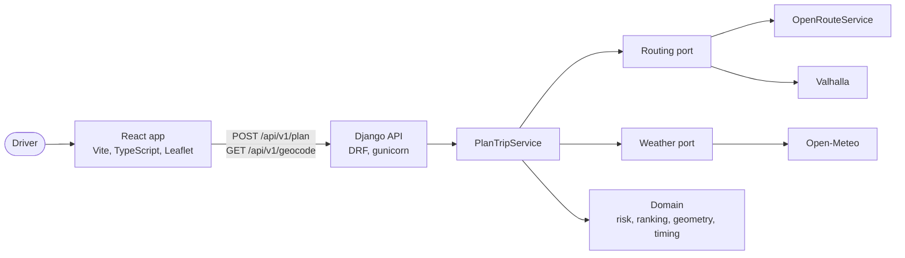
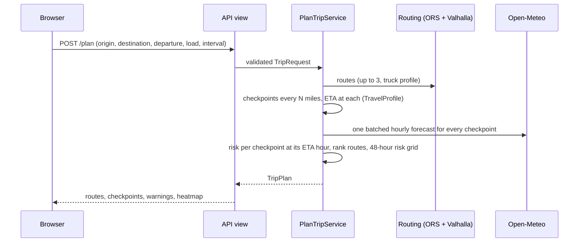

# Architecture

## The big picture

In production one Render service runs gunicorn. Django serves the API under `/api/v1`, the built React files through WhiteNoise, and `index.html` for every page route, so the browser and the API share one origin.

## One trip, step by step

## Backend layers (`backend/apps/trips`)

Dependencies point inward: `api` -> `services` -> `domain`, and `providers` implement ports that `services` use.

| Layer | Responsibility | Notes |
|---|---|---|
| `domain/` | Risk rules, ranking, geometry, ETA, warnings | Pure Python, no Django or HTTP. Frozen dataclasses. 100% covered, property-tested. |
| `providers/` | Adapters for ORS, Valhalla, Open-Meteo and a shared HTTP client | Timeouts, retries on transient failures, caching, typed errors. `SupplementedRouting` combines ORS with Valhalla alternates. |
| `services/` | `PlanTripService`, the one use case | Dependencies injected, so tests use fakes and never touch the network. |
| `api/` | DRF views, serializers, error envelope, throttling, the SPA fallback | Thin: validate, call the service, shape the response. |

Cross-cutting: one error envelope (`{"error": {"code", "message", "details"}}`), per-request IDs in structured JSON logs, throttling, response caching (routes 1 h, geocoding 24 h, weather 30 min), OpenAPI at `/api/docs/`.

## Frontend (`frontend/src`)

- `app/`: router, providers, error boundary. `features/`: `landing`, `planner`, `trip-form`, `routes`, `map`, `heatmap`. `shared/`: API client (responses validated with zod), risk tokens, formatting, UI.
- The 48-hour heatmap is computed on the server and returned with the plan, so the slider only recolours data already in memory. The overlay is drawn on its own canvas in a dedicated map pane, colour always meaning the risk level.

## Quality gates

`make lint typecheck test e2e audit`: ruff and mypy strict on the backend, TypeScript strict and oxlint on the frontend, pytest with a 90% coverage gate, Vitest, Playwright (desktop and phone, with axe accessibility scans), pip-audit and npm audit. CI runs the same checks (`.github/workflows`).

Decisions and their reasons are in [`docs/adr`](docs/adr).
