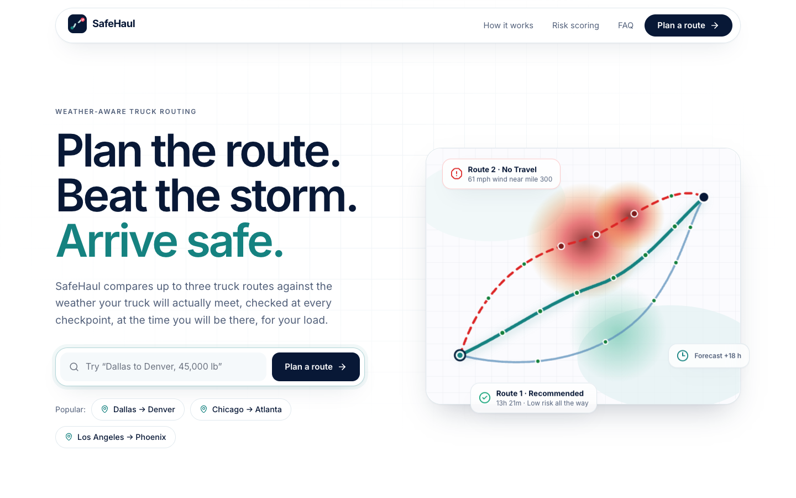
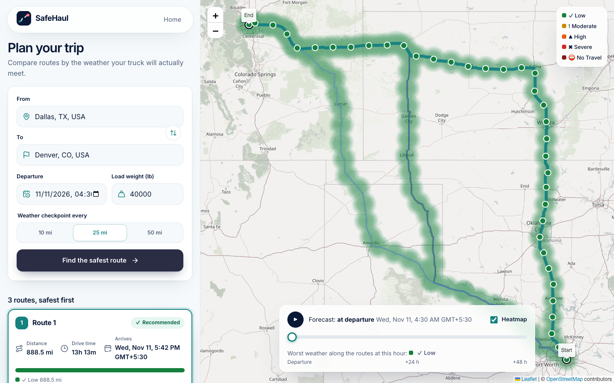
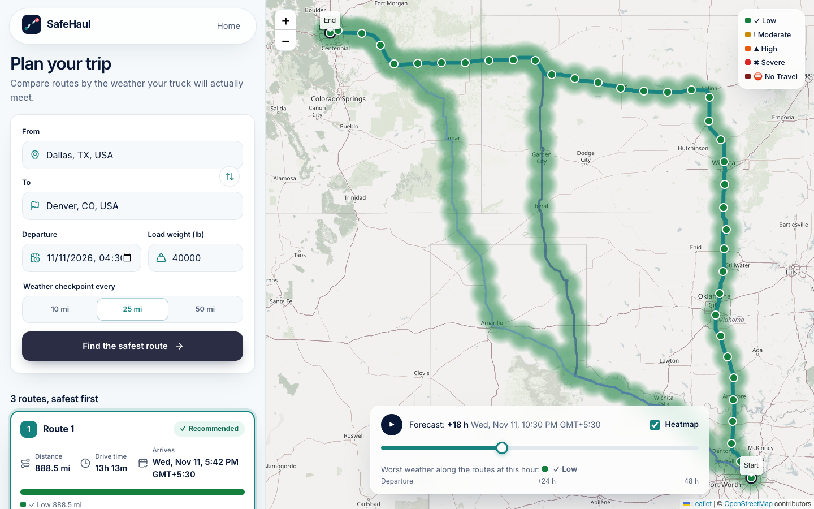
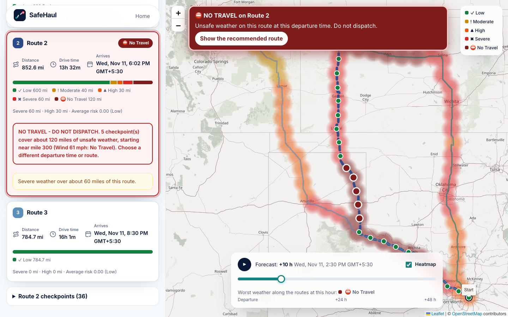
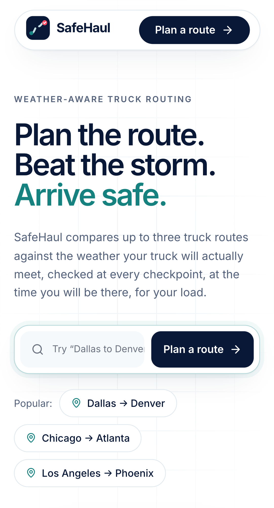

# SafeHaul

**Weather-aware truck routing.** Enter a trip, a departure time and a load weight. SafeHaul finds up to three truck routes, checks the weather at every checkpoint **at the time the truck will be there**, scores each route with the risk and load rules, and recommends the safest one. A 48-hour forecast slider shows how the weather moves along the corridor.

Built for the Full Stack Developer assessment (React + Django).

|  |  |
|---|---|
| **Live app** | https://safehaul-d6fu.onrender.com (free hosting: the first load after idle can take 30-60 s) |
| **Walkthrough (Loom)** | _add the link after recording_ |
| **API docs** | `/api/docs/` on the live app |



## Screenshots

**Compare three routes.** Each card shows distance, drive time, arrival and a bar of the miles at each risk level; the map shows every checkpoint coloured by risk.



**Scrub the next 48 hours.** The corridor re-colours instantly because every hour is calculated on the server and sent with the plan.



**No Travel is impossible to miss.** The route stays visible but is flagged, dashed, ranked last, and the map shows a do-not-dispatch banner. _This screenshot uses simulated storm data, for illustration only; the live app always shows real forecasts._



**Works on a phone.** The map pins to the top once there is a plan, and the controls are touch-sized.



## How to use it

1. Open the app and choose **Plan a route** (or tap a popular trip such as Dallas to Denver to start pre-filled).
2. Type a start and a destination and **pick each from the suggestions** (the form needs a chosen place, not just typed text).
3. Set the **departure** (it defaults to about 30 minutes from now, in your local time), the **load weight** (1 to 120,000 lb) and how often to **sample weather**: every 10, 25 or 50 miles.
4. Press **Find the safest route**. It takes a few seconds the first time; repeat trips are cached.
5. Read the **route cards**, safest first. Click a card or a line on the map to select a route. Click a checkpoint for its ETA and the wind, rain and snow forecast for that hour. The "checkpoints" section lists the same data as a table.
6. Use the **forecast slider** (0 to 48 hours after departure) or press play to watch the weather move. The line under it names the worst weather along the routes at that hour.

Tips: a departure more than about 13 days away is rejected because forecasts only reach about 15 days; some trips honestly show fewer than three routes when there is no genuinely different road.

## What it does

| Brief requirement | Where it lives |
|---|---|
| User enters origin, destination, departure time, load weight | Trip form (`frontend/src/features/trip-form`) |
| Generate 3 route options with a routing API | OpenRouteService truck routes, topped up with Valhalla alternates (`backend/apps/trips/providers`) |
| Sample weather every 10 / 25 / 50 miles at the truck's ETA | Interval selector; ETA from the routing steps (`domain/timing.py`, `services/plan_trip.py`) |
| Risk thresholds and load rules | `backend/apps/trips/domain/risk.py` (boundary-tested, property-tested) |
| Recommend the best route (Severe miles, High miles, average risk, time) | `backend/apps/trips/domain/ranking.py` |
| Show routes, checkpoints, risk, ETAs and summaries on a map | Route cards and Leaflet map (`features/routes`, `features/map`) |
| Weather heatmap with a 0-48 hour forecast slider | Risk overlay and slider (`features/heatmap`) |
| GitHub repository, hosted application, Loom walkthrough | This repository, the live app above, the Loom link above |

## How the risk is scored

Each checkpoint gets the worst of its wind, rain and snow levels, then the load rules raise it.

| | Low | Moderate | High | Severe | No Travel |
|---|---|---|---|---|---|
| Wind (mph) | < 25 | 25-34 | 35-44 | 45-54 | >= 55 |
| Rain (in/hr) | < 0.10 | 0.10-0.25 | 0.25-0.50 | 0.50-1.00 | > 1.00 |
| Snow (in/hr) | < 0.5 | 0.5-1.0 | 1.0-2.0 | 2.0-3.0 | > 3.0 |

Load rules: wind >= 55 mph is No Travel for any load; 45-54 mph with more than 30,000 lb is No Travel; 35-44 mph with more than 40,000 lb is Severe.

Routes are ranked by fewest Severe miles, then fewest High miles, then lowest average risk, then shortest time.

### Assumptions the brief leaves open

Each is recorded as a decision in [`docs/adr`](docs/adr).

- **No Travel routes** stay visible, are flagged and ranked last, and are only recommended if every route has No Travel.
- **Boundaries:** lower bounds are inclusive (rain 0.25 is High). The top bands follow the brief literally (rain 1.00 is still Severe; above 1.00 is No Travel).
- **Miles per level:** each checkpoint stands for the road halfway to its neighbours; Severe and High miles are sums of those stretches. Average risk is mile-weighted.
- **Wind** is sustained 10 m wind speed, not gusts.
- **Fewer than three routes** can appear when no genuinely different road exists (routes that overlap 90% or more are merged).

## Tech stack

| | |
|---|---|
| **Frontend** | React 19, TypeScript (strict), Vite, React Router, TanStack Query, zod, Leaflet, Lucide icons, Inter |
| **Backend** | Django 6, Django REST Framework, drf-spectacular (OpenAPI), WhiteNoise, gunicorn |
| **Data (free)** | Open-Meteo (weather), OpenRouteService and Valhalla (routing, geocoding) on OpenStreetMap data |
| **Quality** | pytest + hypothesis, Vitest + Testing Library, Playwright + axe, ruff, mypy strict, oxlint, pip-audit, npm audit |
| **Hosting** | Render (one free web service) |

## Run it locally

You need Python 3.14, Node 22+ and a free [OpenRouteService key](https://openrouteservice.org/dev/#/signup).

```bash
# one-time setup
make install                      # backend venv + dependencies, frontend packages
cp backend/.env.example backend/.env
# edit backend/.env and set ORS_API_KEY=your-key

# terminal 1: API on :8000
cd backend && source .venv/bin/activate && python manage.py runserver
# terminal 2: web app on :5173
cd frontend && npm run dev
```

Open http://localhost:5173. API docs are at http://localhost:8000/api/docs/.

`make` is optional shorthand: `make test` (unit tests), `make e2e` (browser tests), `make lint typecheck`, `make audit`.

## Architecture

See [ARCHITECTURE.md](ARCHITECTURE.md). In short: a layered Django API (`domain` / `providers` / `services` / `api`) where the risk and ranking logic is pure and fully tested, behind provider ports for routing, geocoding and weather; and a React single-page app that receives everything it needs in one `/api/v1/plan` response.

```
backend/   apps/trips/{domain,providers,services,api}   config/   tests/
frontend/  src/{app,features,shared,styles}              e2e/
docs/      adr/ (decisions)   screenshots/
build.sh   render.yaml   Makefile   .github/workflows/
```

## Tests and quality

- **Backend:** 258 tests, 100% coverage (gate: 90%), including property tests (more wind or a heavier load never lowers the risk).
- **Frontend:** 140 unit tests; 24 Playwright browser tests on desktop and a phone-sized screen, with automated accessibility scans (axe) of the landing page, planner and error states.
- **Static checks:** strict types on both sides, linting and formatting, dependency audits. GitHub Actions runs the same checks.

## Deploy to Render (free)

One web service builds the React app and serves it with Django (no CORS, no second service).

1. Push the repository to GitHub.
2. In Render choose **New > Blueprint**, select the repository, and Render reads [`render.yaml`](render.yaml).
3. When asked, paste your `ORS_API_KEY` (it is never stored in git) and apply.
4. Wait for the first build (a few minutes). Open the service URL and check `/healthz`.

The build is [`build.sh`](build.sh): it builds the frontend, installs the backend, copies the build into `backend/frontend_dist`, and collects static files. Gunicorn then serves the API, the static assets (through WhiteNoise) and the app shell for every page route.

The free tier sleeps after 15 minutes without traffic; the first request afterwards takes 30-60 seconds. Open the app once before a demo to warm it.

Environment variables: `ORS_API_KEY` (required), `DJANGO_SECRET_KEY` (generated by the blueprint), `DJANGO_ALLOWED_HOSTS` (only for a custom domain; the Render hostname is trusted automatically), `VALHALLA_BASE_URL` and `OPEN_METEO_BASE_URL` (optional, to point at self-hosted instances).

## Limits

- OpenRouteService's free tier is about 2,000 requests a day (cached and throttled by the app), and it refuses alternative routes over 100 km, which is why Valhalla supplies them. The public Valhalla and Open-Meteo services are shared; if one is slow or down the app degrades (fewer routes, or an error message) instead of failing silently.
- Map tiles come from OpenStreetMap's volunteer-run servers, which block requests without a `Referer` (the app sends its site origin; see `SECURE_REFERRER_POLICY` in `backend/config/settings/base.py`) and are meant for light use. For real traffic, switch the `TileLayer` URL in `frontend/src/features/map/MapView.tsx` to a keyed or self-hosted tile provider.
- Forecasts reach about 15 days; the 48-hour heatmap needs departures within roughly 13 days.
- SafeHaul is a decision aid, not a substitute for official road and weather advisories.

## Data and credits

Weather: [Open-Meteo](https://open-meteo.com/). Routing and place search: [OpenRouteService](https://openrouteservice.org/) and [Valhalla](https://valhalla.github.io/valhalla/), on [OpenStreetMap](https://www.openstreetmap.org/copyright) data. Map tiles: OpenStreetMap contributors.
